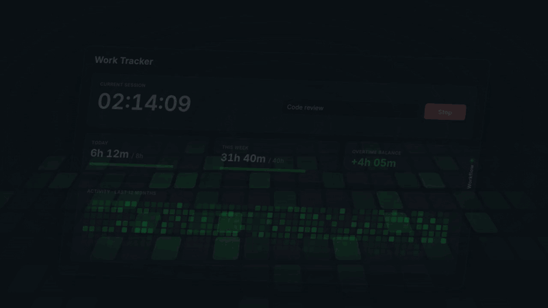

# Workflow — kanban module for Work Tracker

<p align="center">
  <a href="docs/workflow.mp4"></a>
</p>

A kanban board that slides in from the right edge of the Work Tracker page. Cards are connected to
the tracker's timer: start the timer on a card and the time counts as normal tracker time (today,
week, overtime, heatmap) and adds up on the card.

The module doesn't change anything in the tracker. It loads `Tracker/app.py` as it is, adds its API
and panel to the same server, and keeps its board in its own database file.

## Run

```sh
python run.py          # instead of Tracker/app.py — same port, http://localhost:47474
```

Use the tracker's virtualenv if you have one (`../Tracker/.venv/bin/python run.py`, Windows:
`..\Tracker\.venv\Scripts\python run.py`). No extra dependencies besides Flask.

Don't run `Tracker/app.py` at the same time; both use port 47474. On macOS, `autostart.sh` still
starts `app.py`, so point the LaunchAgent at `Workflow/run.py` if you want the board after a login.

## Use

Open the board with the **Workflow** tab on the right edge of the page or press **W**. Close it
with **Esc** or ✕; **↔** switches to full width. The panel remembers whether it was open.

**⌘K** (Ctrl+K on Windows/Linux) opens the **command palette** from anywhere on the page: type to
find any command or card. Commands that need a choice ask for it next, e.g. *Move card to… → card →
column*, *Start timer on… → card*, *Set phase of… → card → phase*, *Filter by type…*, *New bug*,
*Add phase*. ↑↓ and Enter pick, Backspace goes back a step, Esc closes. The ⌘K hint in the search
box opens it too.

| Feature | How |
|---|---|
| **Cards & columns** | **+ New card** at the top or press **A** (opens the card details for a new card in the first column that isn't a done column; **Add card** saves it), **+ Add card** in a column (Enter adds the next one right away), **+ Add column**; drag cards within and between columns |
| **Card details** | Click a card: type, column, phase, priority, due date, estimate, description, labels, checklist. **Save** keeps the changes; Esc, Cancel or a click outside the box closes without saving |
| **Card types** | **Task** (default, no badge), **Bug** (red bug icon) or **Issue** (amber icon); set it in the details, the right-click menu or the palette (*New bug*, *New issue*, *Set type of…*) |
| **Phases** | Milestones until a release (e.g. Alpha → Beta → Release 1.0). **Phases** in the header opens a drawer: add a phase (Enter), drag to reorder, ✎ to rename, set a target date (amber within a week, red when overdue) or mark it released; each shows how many of its cards are done. Click a phase to show only its cards; click it again or its **✕ Show all** to see everything. Cards get a phase in their details, the right-click menu or the palette; new cards get the phase you're filtering by |
| **Quick actions** | Right-click a card: open, start/stop timer, move to a column, type, phase, priority, duplicate, archive, delete |
| **Timer on a card** | ▶ on the card (or **Start timer** in its details). The tracker timer starts with the card title as its note; a timer running for something else is stopped first. Switching within 2 minutes (e.g. right after a card went to *Done*, or after starting the wrong card) doesn't add a session: the new card takes over the running one, from its start |
| **Timer started on the tracker page** | The bar at the top offers **Count it towards a card…**, or use **Link running timer** in a card; the tracker note becomes the card title |
| **Tracked vs. estimate** | Cards show tracked time / estimate, red when over; the details list every session (**Unlink** removes one from the card, not from the tracker) |
| **Columns** | Drag a column to move it (grab its header or any empty space in it); double-click the name to rename it. The column menu (⋯) edits name, colour, WIP limit and *Done column*, and has archive all and delete |
| **WIP limits** | Column menu (⋯) → WIP limit; the column turns red when it has more cards than that |
| **Done column** | Column menu → *Done column*. Cards in it are finished (crossed out, no overdue warning), and when the running card goes there the timer keeps going without it: the card's session ends and a new one without a note starts |
| **Due dates** | Amber for today and tomorrow, red when overdue |
| **Search & filters** | Search title, description, labels and checklist. **Filter** combines type, priority, phase and label; the button shows what's active, *Clear filters* resets it. New cards (**+ New card**, **A**, **+ Add card** in a column) start with the filtered type, priority, phase and label, so they stay visible |
| **Archive** | **Archive** in a card, its right-click menu, or *Archive all cards* in a column menu; the toast offers **Undo** (back where it was). **Archive (n)** in the header opens a drawer next to the board: search, click a card for its details, **Restore** puts it back on top of its column (highlighted), the bin deletes it for good |

Renaming the running card also updates the tracker note. Deleting or archiving a card never deletes
tracked time; the sessions stay in the tracker.

## How it connects

```text
Browser ── /            → tracker page + workflow.css / workflow-boot.js injected
        ── /api/*       → tracker API (unchanged)
        ── /api/workflow/* → this module ── workflow.db
                                         └─ reads/writes sessions in tracker.db (start, stop, link)
```

- `run.py` imports the tracker, registers the module, and starts the server the same way
  `app.py` does (including the come-back watcher on macOS). It doesn't write bytecode into the tracker folder.
- `workflow.py` holds the API and the `workflow.db` schema: `columns`, `cards` (with `type` and
  `phase_id`), `phases`, and `card_sessions` (tracker session id → card). Older `workflow.db` files
  get the new columns and table when the server starts.
- `static/workflow-boot.js` is all the page loads at first: the tab (and its dot while the timer
  runs on a card) and the W / A / ⌘K keys. It loads `static/workflow.js` the first time the board is
  used, so an unused board costs no memory or requests to speak of. While the board is closed or the
  browser tab is hidden nothing runs; open, it refreshes every 10 s and redraws only on changes.
- `static/workflow.js` builds the panel, card dialog and command palette and uses the tracker's CSS variables
  and buttons, so it follows its light and dark theme. After a timer change it calls the tracker
  page's `refreshAll()`, so the clock and tiles update immediately.

| Setting | Environment variable | Default |
|---|---|---|
| Board database | `WORKFLOW_DB` | `workflow.db` next to `run.py` |
| Tracker folder | `TRACKER_DIR` | `../Tracker` |
| Port, tracker database, watcher | `PORT`, `TRACKER_DB`, `WAKE_PROMPT` | as in the tracker |

## Known limits (first version)

- **Adding a break** (on the tracker page) to a card's session splits it in two, and the second part
  isn't linked to the card. Link it again from the card (**Link running timer** while it runs).
- One board.
